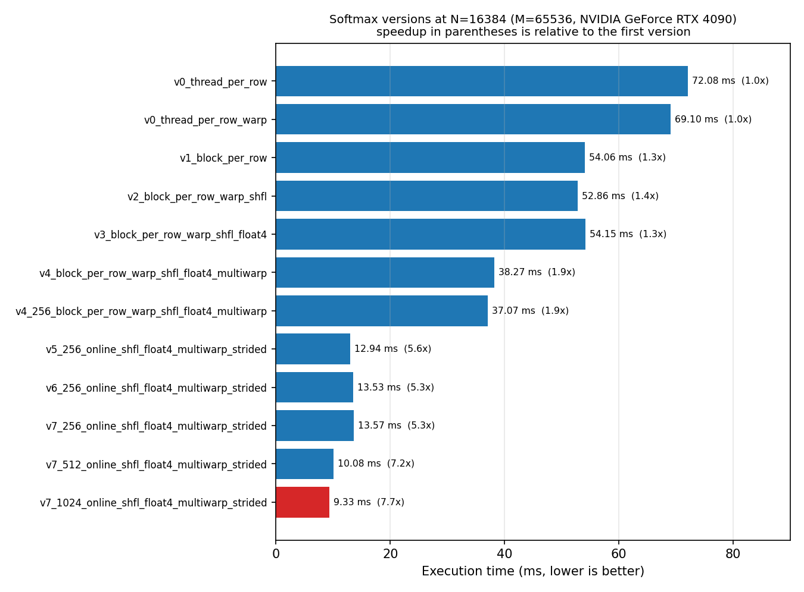
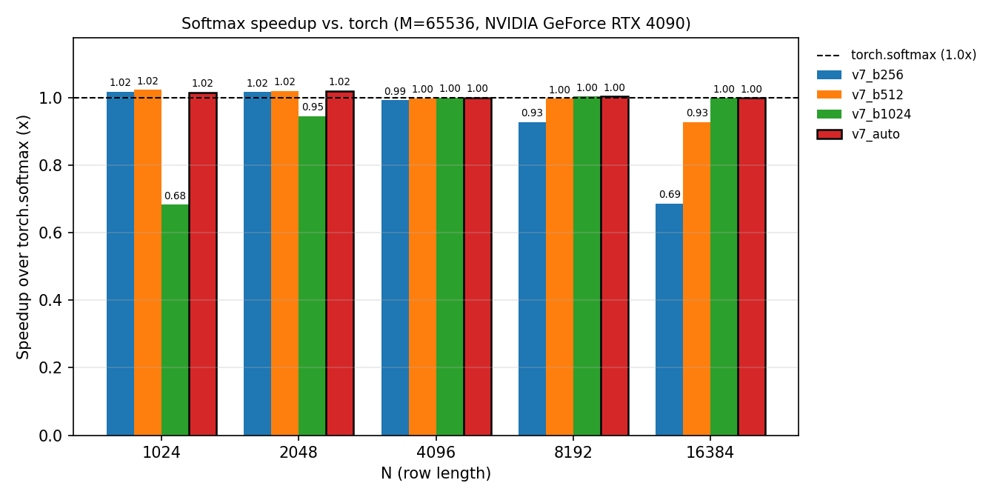
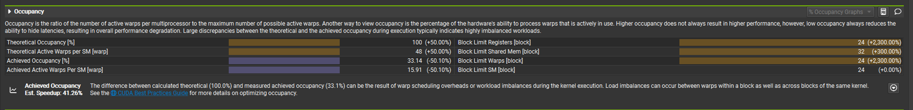
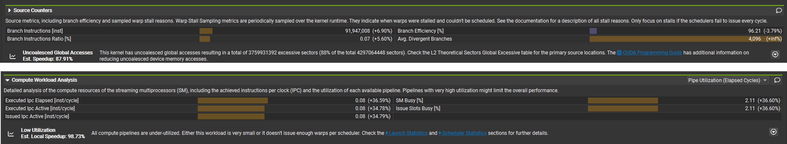
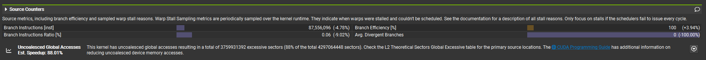
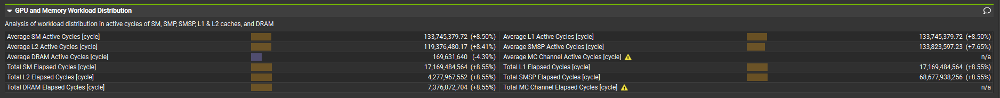
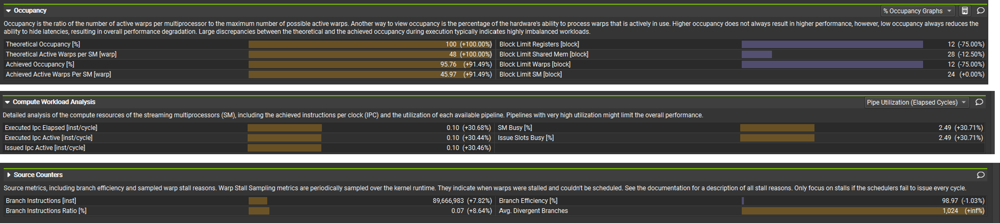
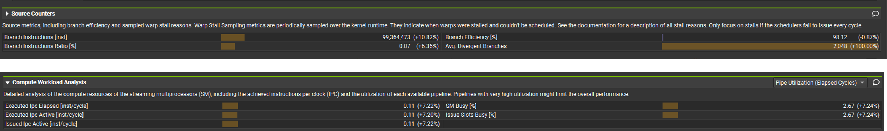

# Softmax on RTX 4090

## 1. Overview

- Softmax implementation optimized step by step
- Experiments run on an RTX 4090 (via vast.ai)
- Optimization effects analyzed with Nsight Compute metrics, and performance compared against PyTorch's softmax

---
## 2. Performance
- Execution time of each softmax implementation on a 65536 x 16384 matrix

- Performance of v7 by block size, relative to PyTorch's softmax, on a 65536 x N matrix

---
## 3. Optimizations and Results (with NCU)

- Each NCU screenshot compares the kernel with the previous-numbered kernel.

### 1. (v0_thread_per_row)
- One thread processes one row
- For numerical stability, the row maximum is subtracted before computing each exponential
- Thread block: ((M + 63) / 64) = (1024), grid: (64)

### 2. (v0_thread_per_row_warp)
- One thread processes one row
- Same kernel as #1
- Thread block: (64), grid: ((M + 63) / 64) = (1024), so the number of threads per block is a multiple of 32
- Lower register usage per thread block increases occupancy

### 3. (v1_block_per_row)
- One thread block processes one row
- Since multiple threads process a single row, synchronization and atomicAdd are used
- Thread block: (32), grid: (M)
- Branch efficiency decreases, but SM busy increases

### 4. (v2_block_per_row_warp_shfl)
- One thread block processes one row
- Threads within the same warp perform the reduction via warp shuffle
- Each thread block consists of a single warp, so no inter-warp synchronization is needed
- Thread block: (32), grid: (M)
- Fewer branch instructions raise branch efficiency; avg. divergent branches = 0

### 5. (v3_block_per_row_warp_shfl_float4)
- One thread block processes one row
- Threads within the same warp perform the reduction via warp shuffle
- Each thread block consists of a single warp, so no inter-warp synchronization is needed
- Vectorized loads using float4
- Thread block: (32), grid: (M)
- Average DRAM active cycles decrease

### 6. (v4_block_per_row_warp_shfl_float4_multiwarp)
- One thread block processes one row
- Threads within the same warp perform the reduction via warp shuffle
- Each thread block consists of multiple warps, so synchronization and atomic operations are needed after the intra-warp reduction
- Vectorized loads using float4
- Indexing: the row is divided into contiguous chunks, one per thread, and each thread accesses its chunk sequentially
- Thread block: (128), grid: (M)
- Synchronization and atomic operations lower branch efficiency, but the larger block size increases occupancy and SM utilization

### 7. (v4_256_block_per_row_warp_shfl_float4_multiwarp)
- One thread block processes one row
- Threads within the same warp perform the reduction via warp shuffle
- Each thread block consists of multiple warps, so synchronization and atomic operations are needed after the intra-warp reduction
- Vectorized loads using float4
- Indexing: the row is divided into contiguous chunks, one per thread, and each thread accesses its chunk sequentially
- Thread block: (256), grid: (M)
- Synchronization and atomic operations lower branch efficiency, but the larger block size increases occupancy and SM utilization

### 8. (v5_256_online_shfl_float4_multiwarp_strided)
- Online softmax
- One thread block processes one row
- Threads within the same warp perform the reduction via warp shuffle
- Each thread block consists of multiple warps, so synchronization and atomic operations are needed after the intra-warp reduction
- Vectorized loads using float4
- Indexing: each thread accesses 4 consecutive elements at a time, then advances by a fixed stride and repeats (strided access)
- Thread block: (256), grid: (M)

### 9. (v6_256_online_shfl_float4_multiwarp_strided)
- Online softmax
- One thread block processes one row
- Threads within the same warp perform the reduction via warp shuffle
- Each thread block consists of multiple warps, so synchronization and atomic operations are needed after the intra-warp reduction
- Vectorized loads using float4
- Indexing: each thread accesses 4 consecutive elements at a time, then advances by a fixed stride and repeats (strided access)
- float4 also used for stores
- Thread block: (256), grid: (M)

### 10. (v7_256_online_shfl_float4_multiwarp_strided)
- Online softmax
- One thread block processes one row
- Threads within the same warp perform the reduction via warp shuffle
- Each thread block consists of multiple warps, so synchronization and atomic operations are needed after the intra-warp reduction
- Vectorized loads using float4
- Indexing: each thread accesses 4 consecutive elements at a time, then advances by a fixed stride and repeats (strided access)
- float4 also used for stores
- Loop unrolling applied
- Thread block: (256), grid: (M)

### 11. (v7_512_online_shfl_float4_multiwarp_strided)
- Online softmax
- One thread block processes one row
- Threads within the same warp perform the reduction via warp shuffle
- Each thread block consists of multiple warps, so synchronization and atomic operations are needed after the intra-warp reduction
- Vectorized loads using float4
- Indexing: each thread accesses 4 consecutive elements at a time, then advances by a fixed stride and repeats (strided access)
- float4 also used for stores
- Loop unrolling applied
- Thread block: (512), grid: (M)

### 12. (v7_1024_online_shfl_float4_multiwarp_strided)
- Online softmax
- One thread block processes one row
- Threads within the same warp perform the reduction via warp shuffle
- Each thread block consists of multiple warps, so synchronization and atomic operations are needed after the intra-warp reduction
- Vectorized loads using float4
- Indexing: each thread accesses 4 consecutive elements at a time, then advances by a fixed stride and repeats (strided access)
- float4 also used for stores
- Loop unrolling applied
- Thread block: (1024), grid: (M)
